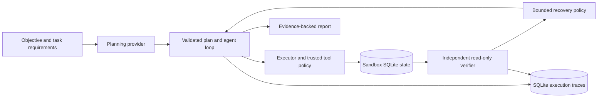

# VeriAgent

**An executable research sandbox for evidence-grounded verification and bounded recovery.**

VeriAgent separates what a tool *reports* from what an application *persisted*. Phase 1
implements a small, complete experiment: a tool claims it updated an issue, but silently
drops the write. A baseline accepts the claim, a verifier detects the mismatch, and a
recovery agent selectively retries the idempotent update and checks the result.

The default demo is deterministic. Optional OpenAI interpretation and planning are
available, with a proposal/review/execution flow for broader objectives; see
[the provider guide](docs/OPENAI_PROVIDER.md) and [reviewed interpretation](docs/INTERPRETATION.md).
An optional [dynamic engine](docs/DYNAMIC.md) chooses one tool call from observations at
a time; the static engine remains the default for reproducible comparisons.
Optional [model budgets](docs/MODEL_BUDGETS.md) cap cumulative output allowances and
stop on observed total-token or estimated-cost thresholds.
Optional [process-isolated tools](docs/PROCESS_EXECUTION.md) terminate hung sandbox workers
and use authoritative state to resolve interrupted writes.
An [offline adversarial suite](docs/SAFETY_EVALUATION.md) checks 24 fixed boundary cases
and saves state-oracle evidence, traces, fixture hashes and source fingerprints.
This is a research prototype, not a general autonomous agent. The hypothesis
that verification and adaptive recovery improve reliability at acceptable cost remains
unproven outside these controlled scenarios. No model benchmark results are claimed.

## Install and run

Requires Python 3.11+ and [uv](https://docs.astral.sh/uv/). No API key is needed.

```console
uv sync --extra dev --locked
uv run pytest
uv run ruff check .
uv run ruff format --check .
uv run veriagent demo
uv run veriagent smoke
uv run veriagent demo --engine dynamic
uv run veriagent evaluate-safety
```

In this Windows checkout, setup placed uv at `.tools/uv.exe` and Python inside
`.tools/python/`. If uv is not on your PATH, replace `uv` with `.\.tools\uv.exe`
in these commands. These local runtime files are ignored by Git.

Alternatively, install into an activated virtual environment with
`python -m pip install -e ".[dev]"`, then run `pytest` and `veriagent demo`.

```console
uv run veriagent demo --scenario clean
uv run veriagent demo --scenario transient
uv run veriagent demo --scenario persistent_drop
uv run veriagent run "Set ISSUE-1, ISSUE-2 to done" --silent-drops 1
uv run veriagent run "Mark ISSUE-3 as in_progress" --mode verify
uv run veriagent serve
```

The API binds to `127.0.0.1:8000`; explore its schema at
[local API docs](http://127.0.0.1:8000/docs). It is an unauthenticated local test application.
Do not expose it to a network. Tests use in-process FastAPI clients and temporary databases.

The direct `run` interface deliberately accepts only `Set/Mark ISSUE-N[, ISSUE-N] to/as
open|in_progress|done`. Unsupported text is rejected in full. This is a constrained
interface. For phrases such as `Close ISSUE-1 and start ISSUE-2`, use `propose`, then
`review`, then `execute --approve <digest>`. Every provider defaults to the offline mock.

## Understanding the demo

Every demo invocation creates a new UUID directory under `artifacts/`. Each mode gets an
independent, freshly seeded database and the same fault configuration. In `silent_drop`,
the first write reports success without persisting. For the default static engine:

| Mode | Agent claims success | Independent final audit | Writes attempted | Retries |
|---|---|---|---|---|
| baseline | yes | incomplete | 1 | 0 |
| verify | no | incomplete | 1 | 0 |
| recover | yes | complete | 2 | 1 |

These are designed scenario outcomes, not evidence of a general reliability improvement.
Run the command to obtain actual reports, including measured machine-dependent latency.

`comparison.json` records the task, report, audit outcome, false-success indicator,
recovery indicator, action count, latency, model tokens, and estimated model cost per run.
There is no model call in Phase 1: token count and model cost are zero, not an estimate
of total compute cost. Unsafe actions are zero by construction: only local issue reads
and absolute status assignments exist. They are not measured against an external safety oracle.

Each mode also has a JSON event trace and a readable text trace. `traces.sqlite` retains
ordered task, configuration, plan revisions, actions, observations, verification evidence,
recovery decisions, and terminal reports. Every evidence item records expected and actual
status, row version, and the authoritative source. The final `evaluation_audit` occurs
**after** execution and never informs baseline planning, retrying, or claims.

`run` reuses its specified database; `seed()` never resets existing issues. Use a fresh
`--db` path or the paired demo when comparing modes. `run` exits with code 1 on a reported
failure, 2 for invalid arguments, and 0 for a claim of success. A baseline exit code 0
deliberately does not certify completion; `verified_success` is null in baseline mode.

## Architecture



| Module | Responsibility |
|---|---|
| `models.py` | Pydantic task, plan, dependency, action, observation, evidence, budget and report contracts |
| `planner.py` | Provider protocol and deterministic objective parsing / planning |
| `interpretation.py` | Conservative offline intent parsing, proposals and content-bound review |
| `openai_provider.py` | Optional structured interpretation/planning, request limits and accounting |
| `sandbox.py` | Local application state, idempotent writes, controlled tool faults |
| `executor.py` | Tool allowlist, trusted idempotency policy, exception classification, deadlines |
| `verification.py` | Separate read-only database connection and consistent snapshot |
| `recovery.py` | Failure policy and selective revision for unmet requirements |
| `agent.py` | Execution loop, action / time / retry budgets and evidence-backed termination |
| `dynamic.py` | Per-decision tool authorization, normalized feedback and verified dynamic recovery |
| `budgeting.py` | Per-run request admission, cumulative usage limits and explicit stop reasons |
| `isolated.py`, `worker.py` | Fixed sandbox tools in per-action workers with deadline termination |
| `trace.py` | Durable events, JSON export and readable trace rendering |
| `evaluation.py` | Paired scenario runner and post-run audit |
| `safety_evaluation.py` | Scripted boundary corpus, independent final-state oracle and regression reports |
| `smoke.py` | Fresh dropped-write smoke checks and evidence bundles for either provider |
| `api.py`, `cli.py` | Optional local HTTP application and reproducible commands |

## Safety and limitations

- Plan targets and statuses must match the original task requirements. Provider output
  cannot grant itself permissions or declare an operation idempotent. Tool payload text
  remains observation data and is never interpreted as instructions.
- Only unmet requirements are retried. Missing issues, permission errors, internal errors,
  and unsafe retries terminate. Transient failures, state mismatches, and timeouts may be
  retried within the configured budget. Default limits: 20 actions, 2 recovery attempts,
  10 seconds per agent run and 1 second per action. Dynamic execution also limits decisions
  to 20. CLI `execute` and `smoke` use a 60-second run budget by default.
- Status assignment is idempotent, including its version counter: an already satisfied
  assignment does not increment version. There are no non-idempotent or external tools.
  No rollback mechanism is needed for these absolute assignments; remote side effects,
  compensation and deduplication need separate designs.
- Default in-process timeouts are cooperative. Optional `--isolate-tools` runs each fixed
  sandbox tool in a worker that can be killed at its wait deadline. Cleanup adds bounded
  overhead, and an interrupted write may already have committed. Planning, tracing,
  verification and OS process creation are not all forcibly interruptible. This is not
  a hard real-time guarantee or an OS security sandbox; see the process-execution guide.
- Independent means independent of executor claims, not cryptographically trusted.
  A compromised database or concurrent external mutation can invalidate evidence.
  Verification checks final statuses, not causal attribution or intermediate correctness.
- Traces are local plaintext, append-only by application convention; they are not
  tamper-proof. Do not store secrets in objectives or sandbox issue contents.
- OpenAI planning requires explicit `--provider openai`, an installed optional SDK and
  environment credentials. The demo always uses the offline mock. `.env` is not auto-loaded.
  Unsupported paid integrations never silently fall back to mocks. No live paid call has
  been validated; SDK integration tests use an in-memory HTTP transport.

See [the roadmap](docs/ROADMAP.md), [architecture decisions](docs/ARCHITECTURE.md),
the [evaluation protocol](docs/EVALUATION.md), and the
[bounded repeated-trial benchmark](docs/BENCHMARK.md). Recorded local validation lives in
[VALIDATION.md](docs/VALIDATION.md).
