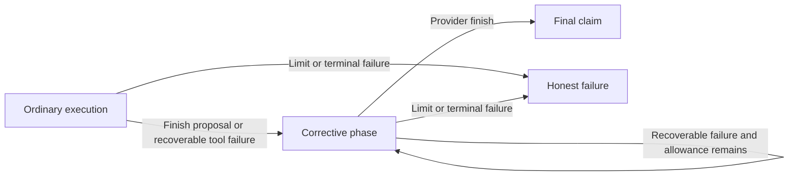

# Mock-only observation-based self-reflection prototype

`ReflectionAgent` in `veriagent.reflection` implements a separate Python prototype for the
[comparator design](COMPARATOR_DESIGN.md). Its provider is a deterministic decision rule,
not an LLM. It accepts only MockReflectionProvider, has no verifier argument or live-provider
adapter, and adds no Mode, RunReport variant or CLI option to existing experiments.

Given an existing sandbox and TraceStore:

```python
from veriagent.executor import Executor
from veriagent.models import Budget
from veriagent.reflection import ReflectionAgent

agent = ReflectionAgent(Executor(sandbox), traces,
                        Budget(max_actions=8, max_decisions=8, max_retries=2))
# report = agent.run(original_task)
```

Use a separate final SQL audit outside the comparator to measure actual task outcomes.
Existing baseline/verify/recover agents and their reports remain unchanged.

## Typed phases and shared limits



ReflectionState exposes only the authoritative phase, original Budget, action/decision/
corrective counters and at most 16 normalized feedback entries. Feedback contains action,
reported success, failure and observed read status; raw tool text/titles, trusted
verification, fault schedules and oracle quota state are excluded. The typed state forbids
additional fields. The provider receives the original validated task separately.

Ordinary mock execution reads targets and accepts successful write acknowledgements.
A finish proposal records `original_claimed_success: true` but is not the final claim:
it requests a corrective-phase admission. A recoverable tool error can request correction
before any finish proposal, in which case the original success-claim field is false.
Planning failure before either leaves that field null.

Each corrective phase starts fresh observation feedback. The mock rule reads all targets,
repairs observed mismatches and reads back after each write before proposing finish.
Transport/time-out failures can request another phase; permission, missing-target, internal
or unconfirmed-cleanup failures stop. Successful acknowledgements that still leave an
observed mismatch can cause more work within a phase; phase admissions and repair writes
are therefore different counters.

Corrective admissions are at most two and cannot exceed Budget.max_retries. Every tool
call and decision, including both finish proposals, consumes the shared action/decision
envelope. No extra allowance is granted on phase entry. The prototype defaults to eight
actions, eight decisions and Budget's existing timeout defaults. All deadlines remain
cooperative, not a real-time guarantee. Mock model calls/tokens are zero; any future LLM
provider needs explicit metering and output-budget integration before use.

Writes must match the original task's issue/status authorization. Repeated writes require
a newer successful ordinary read since that issue's previous write, corrective phase and
the executor's safe-retry policy. A post-commit timeout can therefore be resolved by
read-back without a duplicate write. No trusted StateVerifier is called.

## Reports and traces

ReflectionReport uses a distinct schema-1 `comparator: mock_self_reflection` contract.
It records original/final claims, actions, decisions, corrective admissions, write attempts,
repeat writes, corrective writes, failure and elapsed time. `verified_success` is always
null: a final finish is still a provider claim. Schema version values require exact integers.

Trace events include `reflection_context`, `reflection_decision`, `reflection_transition`,
`reflection_claim`, terminal reasons and `reflection_report`, plus ordinary action and
observation records. Raw tool observations can remain in the trace for auditing; they are
not passed wholesale into provider context. This is not a general redaction or injection-
resistance guarantee.

## What the tests establish

Focused tests cover clean execution, one-shot dropped writes, pre-commit errors, ambiguous
post-commit timeout read-back, persistent faults and shared/corrective caps. They also
cover task authorization, unsafe retries, late decisions, unsafe cleanup, hidden-context
field rejection, canary exclusion, provider restriction and fresh counters on reused agents.

A spoofed ordinary-read fixture produces a final success claim while the independent SQL
audit fails. That false claim is deliberately retained: observation-based reflection is
not authoritative verification. The mock's deterministic read/repair rule does not establish
LLM reflection quality, broad recovery reliability or equal cost versus trusted verification.

No comparator study or live API trial is claimed here. A prospective common-corpus plan
must identify this prototype separately, account for its extra ordinary reads and finish
decisions, preserve realized exposure and include a separate final-state oracle.
The [common-corpus specification](REFLECTION_COMPARISON.md) now records those selections
and gates; its 96 planned conditions have not been executed.

Adding this source module deliberately changes the current source inventory. Historical
plans and evidence hashes are preserved; their runners must reject silently rerunning
the old pinned study on changed code. Unit-test plans refresh only their temporary source
fingerprints. The portable historical evidence checker remains independent of original
absolute paths and does not execute the embedded runner.
